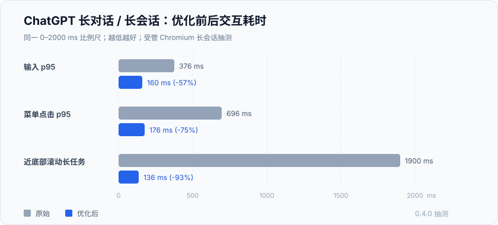
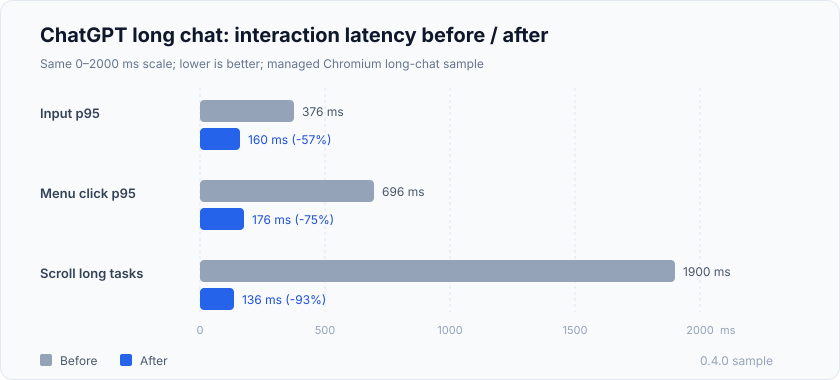

# ChatGPT 网页长对话交互卡顿优化

[English](#english)

一个默认开启、无面板的 Tampermonkey 用户脚本，专门优化 **ChatGPT 网页版（chatgpt.com）的长对话 / 长会话交互卡顿**：解决输入迟钝、删除掉帧、菜单点击延迟和滚动卡顿。装好后不需要配置，也不会改变模型上下文或发送内容。

**这是浏览器端的 ChatGPT 网页优化**：只改善页面交互响应，不加速模型生成，也不修改对话内容；不是 API、桌面客户端或模型服务。

*由 10 月 17 日发布的 DeepSeek V4.1 Flash-1017（deepseekv4.1flash-1017）完成优化；蓝色大肥鱼不只吃白饭了！*

脚本默认启用，不再要求会话达到某个节点数；出现完整回答后，会等它稳定再应用。旧回答收起只在确实很重的多回答会话里做，避免短对话被改得面目全非。

## 0.4.4 更新

- **生命周期自愈**：页面从后台恢复、ChatGPT 替换主区域、静态副本被移除时，脚本会释放旧观察器并重新建立显示层。
- **失败退避与误报修正**：显示层初始化失败会清理状态并退避重试；只有连续多次真实失败才显示故障提示，不再把回答延迟渲染误判为页面结构变化。

## 0.4.5 更新

- **过期副本修复**：继续对话时，即使页面没有流式标记，也会给最新回答保存“文字长度 + 节点数”签名；内容变化时立即恢复原回答，等稳定后再重建副本，避免部分内容一直不显示、只能刷新页面。
- **健康检查校验签名**：生命周期自愈也会检查静态副本是否过期，发现内容不一致时重新建立。

## 0.4.6 更新

- **修复按钮控件失效**：修复脚本导致的 ChatGPT 回答中按钮控件失效问题。最新回答里出现 ChatGPT 的 pressable 引用、span[role="button"]、输入框或下拉控件时，不再建立静态副本，保留原节点和 React 事件链，避免点击引用没有弹层或跳转。
- **普通外链不受影响**：没有上述控件的回答仍正常使用静态副本；普通 a href 外链保持完整地址。

## 0.5.0 更新

- **收回两处负优化**：0.4.5 的「文字长度 + 节点数」精确签名会让静态副本反复重建（页面隐藏回答后会做一次懒渲染收缩，签名因此抖动；实测单场景长任务最长 9.7 秒）；0.4.6 的 pressable 保护会让几乎每条带引用角标的最新回答都不再建立副本。0.5.0 只在两种情况下撤销或跳过副本：内容确实比副本更长，或回答里真的有输入框/下拉框。
- **引用角标可以正常点开**：带引用角标的回答照常使用静态副本；点击引用时脚本先恢复原节点再转发这一次点击，弹层位置与关闭脚本时一致。
- **停车力度回到 0.3.3**：在底部时，完全离开视口上方的旧回答都会收起；不在底部时留 1.5 个视口。恢复只在占位接近视口时发生，并在恢复后 3 秒内不再收起。
- **健康检查不再整层重置**：只重新绑定观察器、只补建最新回答的副本，不会把已收起的旧回答全部展开。

## 它解决什么问题

ChatGPT 聊得越久，页面里的回答越多，下面这些操作会越来越慢：

- 在输入框里打字、删除文字，尤其是中文输入法组合输入时，光标和文字有明显延迟。
- 打开/关闭附件菜单、模型菜单等按钮时，要等一下才响应。
- 从长对话底部向上滚，或者滚回底部露出“ChatGPT 可能会出错”时掉帧。

这不是网络慢，也不是模型回复慢，而是浏览器在反复重排已经很多的消息。脚本的目标是让这些**交互**更顺滑，而不是加速模型。

## 原理（尽量说人话）

ChatGPT 每次输入或点击，都会触发它自己的布局读取和样式失效，让整段回答反复参与样式计算。脚本做了三件事：

1. **旧回答按需收起来**：只在确实很重的多回答会话中，把较早的助手回答在原位置收起，只留一个等高的占位；滚到附近再自动展开，位置和滚动高度不乱。
2. **最新回答用静态副本**：把最新一条已完成的回答做成静态副本，原节点隐藏；副本里的块级内容只渲染看得见的部分。回答里真的带输入框/下拉框时保留原节点、不建立副本；只带引用角标时仍建立副本，点击引用会先恢复原节点再转发点击。
3. **减少观察器风暴**：合并页面里反复触发的文档级 MutationObserver/ResizeObserver，跳过没有语义变化的重复属性写入。

脚本不拦截 React 事件，不改输入框，不改模型上下文，也不向外部发送数据。

## 优化前后：数据对比

同一台机器、同一个约 2.2 万 DOM 元素的长对话、同一组输入/菜单/滚动操作；数字是受管 Chromium 上的抽测，单位毫秒，越低越好。

| 指标 | 原始 | 优化后 |
| --- | --- | --- |
| 输入 p95 | 376 ms | 160 ms（约 -57%） |
| 菜单点击 p95 | 696 ms | 176 ms（约 -75%） |
| 近底部滚动长任务合计 | 约 1900 ms | 136 ms（约 -93%） |
| 输入/菜单长任务合计 | 7.4～8.0 s | 0.74～1.6 s |

补充说明：

- 首次自动展开一条旧回答，可能出现约 0.35 秒的一次性布局；这是恢复几千个节点的正常成本，不是持续卡顿。
- 真实体验会受浏览器、扩展、CPU 和 ChatGPT 前端版本影响；如果你装了翻译类或其他 ChatGPT 脚本，结果可能不同。
- 这些数字是交互耗时，不是模型回复速度，也不是正式 INP 指标。

## 安装使用

1. 确保浏览器已安装 [Tampermonkey](https://www.tampermonkey.net/)。
2. **[点击这里一键安装用户脚本](https://raw.githubusercontent.com/CJ-tpub/chatgpt-long-chat-smooth/main/chatgpt-long-chat-smooth.user.js)**；也可以在仓库里复制 chatgpt-long-chat-smooth.user.js，手动新建脚本并保存。
   也可以从 [Greasy Fork 安装](https://greasyfork.org/zh-CN/scripts/601032)。GitHub 与 Greasy Fork 是同一个脚本的两个入口，任选其一；反馈可发到 [Greasy Fork 反馈页](https://greasyfork.org/zh-CN/scripts/601032/feedback) 或 [GitHub Issues](https://github.com/CJ-tpub/chatgpt-long-chat-smooth/issues)。
3. 刷新一个 ChatGPT 网页长对话页面即可生效；脚本静默运行，没有常驻面板，也不需要配置。
4. 要停用，在 Tampermonkey 中关闭脚本并刷新页面。

## 兼容与限制

- 正式版没有常驻面板、菜单或关闭按钮；要停用直接在 Tampermonkey 禁用脚本。
- 只在 https://chatgpt.com/* 的对话页启用；首页或没有助手回答的页面不会修改。短对话也会为最新回答建立静态副本，但不会收起旧回答。
- 最新回答是静态副本；如果某条内联控件依赖 React 内部状态，桥接可能失败，停用脚本并刷新即可恢复。
- 最新回答包含输入框、下拉框或可编辑区域时，脚本会保留原回答、不建立静态副本（这类控件复制后无法输入）；只带引用角标 `span[role="button"]` 的回答仍使用副本，引用弹层通过「先恢复原节点再转发点击」正常工作。
- 回答正在流式生成、重新生成时，脚本会先显示原节点，稳定后再应用；生成过程中看到原始回答是预期行为。
- ChatGPT 前端结构改版可能导致脚本无法识别；只有轻量显示连续初始化失败、退避重试仍未恢复时，右下角才会出现临时提示，页面保持原样。

## 隐私

脚本不发起网络请求，不上传任何数据；所有收起/恢复和布局处理只发生在当前页面内存中，不收集对话正文、按键内容、消息 ID 或会话 URL。

## 适用场景与关键词

适合：ChatGPT 长对话卡顿、长会话输入延迟、菜单点击不跟手、长对话滚动掉帧，以及希望脚本默认开启、无感运行的用户。

搜索关键词 / Keywords

ChatGPT 网页长对话交互卡顿优化、ChatGPT 网页卡顿优化、ChatGPT 长对话交互卡顿优化、ChatGPT 长会话交互卡顿优化、长对话卡顿、长会话卡顿、长对话输入延迟、长会话点击卡顿、长会话滚动卡顿、ChatGPT 网页流畅、长对话顺滑、长会话优化、Tampermonkey 性能脚本、userscript、ChatGPT smooth、ChatGPT web performance、smoother interactions、long ChatGPT conversation lag、long chat interaction performance、smoother long conversations、content-visibility。

## License

PolyForm Noncommercial 1.0.0，见 LICENSE。允许个人和非商业使用、修改、分发；禁止商业用途。

如需商业授权，请通过 [Issues](https://github.com/CJ-tpub/chatgpt-long-chat-smooth/issues) 联系维护者。

---

## English: ChatGPT Web Long Chat Interaction Optimizer

A default-on, no-panel Tampermonkey userscript for **long conversations on the ChatGPT web app (chatgpt.com)**. It makes typing, deleting, menu clicks and scrolling feel smoother. No setup, no model or context changes.

This is a **browser-side optimization for the ChatGPT web app**: it improves interaction responsiveness only. It does not speed up model generation, change the conversation, or work with the API or a desktop client.

*Optimized with DeepSeek V4.1 Flash-1017, released on October 17. The big blue fish is no longer just eating plain rice!*

The script is on by default and no longer waits for a conversation to reach a certain node count. Once a complete answer appears, it waits for the answer to stabilize before applying. Older answers are parked only in genuinely heavy multi-answer threads, so short chats are left mostly intact.

### What's new in 0.4.4

- **Lifecycle self-healing**: when the page returns from the background, ChatGPT replaces the main region, or the static twin is removed, the script releases the stale observer and rebuilds the display layer.
- **Retry with backoff, fewer false alarms**: initialization failures now reset state and retry with backoff; the fault notice appears only after repeated real failures, not when an answer is simply still rendering.

### What's new in 0.4.5

- **Stale twin fix**: during continued conversation, the script now tracks a lightweight signature (text length + descendant count) even when ChatGPT sets no streaming marker. When the latest answer changes, it immediately restores the original answer and waits for it to stabilize before rebuilding the twin. This prevents partially loaded or stale answer content.
- **Signature-aware health check**: lifecycle recovery also verifies that the static twin still matches the latest answer.

### What's new in 0.4.6

- **Fixed broken button controls**: fixes button controls in ChatGPT answers that were broken by the script. When the latest answer contains ChatGPT pressable citations, span[role="button"], inputs, textareas, or selects, the script keeps the original node instead of building a static twin, preserving React event handlers and popovers.
- **Ordinary links still work**: answers without those controls still use the static twin; normal a href links keep their full URLs.

### What's new in 0.5.0

- **Two negative optimizations removed**: the exact "text length + node count" signature added in 0.4.5 made the twin rebuild itself repeatedly (hiding an answer triggers a lazy-render shrink, so the signature kept changing; the worst long task measured 9.7 s in one scenario). The 0.4.6 pressable guard made almost every answer with citation chips skip the twin entirely. 0.5.0 only drops the twin when the content is genuinely longer than the snapshot, or when the answer really contains inputs or selects.
- **Citation chips work again**: answers with citation chips still use the static twin; clicking a citation first restores the original node and then forwards the click, so popovers anchor exactly as with the script disabled.
- **Parking strength back to 0.3.3**: while at the bottom, every older answer fully above the viewport is parked; otherwise a 1.5-viewport margin is kept. Restore happens only when a placeholder approaches the viewport, and a restored answer is not parked again for 3 seconds.
- **Non-destructive health check**: it only re-binds the observer and rebuilds the latest answer's twin; it never expands all parked answers.

### What it fixes

- **Typing and deleting lag**: noticeable delays when typing (especially with an IME) or deleting text in a long thread.
- **Menu response delay**: attachment or model menus take a moment to respond.
- **Scroll jank**: frame drops when scrolling up from the bottom or revealing the “ChatGPT can make mistakes” footer.

This is caused by the browser repeatedly recalculating layout across thousands of DOM nodes, not by network latency or model speed. The script optimizes **interaction responsiveness**, not model generation speed.

### How it works

1. **Park older answers only when needed**: in heavy multi-answer threads, older assistant turns are hidden with an equal-height placeholder and restored near the viewport, so page height and scroll position stay stable.
2. **Use a static twin for the latest answer**: the newest completed turn is copied into a static node; the original is hidden and only visible blocks are rendered. If the answer contains inline citations, buttons, or input controls, the original node is kept instead, preserving React popovers and handlers.
3. **Calm observer storms**: document-level MutationObserver/ResizeObserver callbacks are coalesced, and same-value attribute writes are skipped.

It does not intercept React events, change the composer, alter model context, or send data anywhere.

### Before / after

Same machine, same long conversation with about 22k DOM nodes, same typing/menu/scroll actions. Managed Chromium sample; milliseconds, lower is better.

| Metric | Before | After |
| --- | --- | --- |
| Input p95 | 376 ms | 160 ms (about -57%) |
| Menu click p95 | 696 ms | 176 ms (about -75%) |
| Near-bottom scroll long tasks | about 1900 ms | 136 ms (about -93%) |
| Input/menu long tasks | 7.4–8.0 s | 0.74–1.6 s |

Notes:

- The first automatic restore of an old answer can cost about 0.35 s of one-time layout; that is the cost of putting thousands of nodes back, not continuous jank.
- Real results vary with browser, extensions, CPU and the ChatGPT frontend version.
- These are interaction timings, not model response speed or official INP.

### Install

1. Install [Tampermonkey](https://www.tampermonkey.net/).
2. **[Install the userscript with one click](https://raw.githubusercontent.com/CJ-tpub/chatgpt-long-chat-smooth/main/chatgpt-long-chat-smooth.user.js)**, or copy chatgpt-long-chat-smooth.user.js into a new Tampermonkey script.
   You can also install from [Greasy Fork](https://greasyfork.org/zh-CN/scripts/601032). GitHub and Greasy Fork are two entry points for the same script; pick one. Feedback: [Greasy Fork](https://greasyfork.org/zh-CN/scripts/601032/feedback) or [GitHub Issues](https://github.com/CJ-tpub/chatgpt-long-chat-smooth/issues).
3. Refresh a long ChatGPT web conversation. The script runs silently: no panel, no configuration.
4. To stop, disable it in Tampermonkey and refresh the page.

### Limits

- No persistent panel, menu or close button; disable the script in Tampermonkey to stop it.
- Only activates on conversation pages on https://chatgpt.com/*; home and no-answer pages are untouched. Short chats still get a static twin for the latest answer, but older answers are not parked.
- The latest answer is a static snapshot. If an inline control depends on React state, the click bridge may fail; disable the script and refresh to recover.
- When the latest answer contains inputs, selects or editable regions, the script keeps the original answer and does not build a twin (those controls cannot work inside a copy). Answers that only contain citation chips (`span[role="button"]`) still use the twin; citation popovers work by restoring the original node before forwarding the click.
- Streaming or regenerating answers temporarily show the original node; this is expected.
- A ChatGPT frontend change may make the structure unrecognized; a temporary notice appears only after repeated real initialization failures and retries, and the page is left untouched.

### Privacy

No network requests. No analytics or uploads. All parking/restoring and layout work stays in page memory. The script does not collect conversation text, key presses, message IDs or chat URLs.

### Keywords

ChatGPT long conversation interaction lag, ChatGPT long chat performance, smoother long conversations, ChatGPT input latency, ChatGPT click lag, ChatGPT scroll jank, Tampermonkey userscript, long conversation optimization, smooth interactions.

### License

PolyForm Noncommercial 1.0.0. See LICENSE for the full terms. Personal and noncommercial use, modification and distribution are allowed; commercial use is prohibited.

For commercial licensing, please contact the maintainer via [Issues](https://github.com/CJ-tpub/chatgpt-long-chat-smooth/issues).
